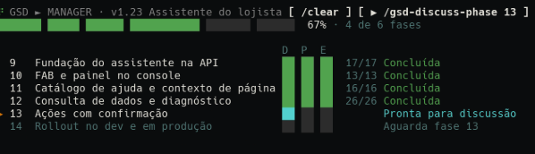

# gsd-band

Um painel fixo acima do prompt do Claude Code que mostra em que ponto está o milestone GSD do projeto. São as mesmas informações do `/gsd-manager`, sem precisar rodar o comando.



Em projetos sem milestone em andamento o painel não aparece e não ocupa espaço.

## Instalação

No prompt do Claude Code:

```
/plugin install gsd-band --marketplace luizfbalves/claude-gsd-band
```

Pelo shell:

```
claude plugin install gsd-band --marketplace luizfbalves/claude-gsd-band
```

No app desktop, onde `/plugin` não funciona: clique em **+** ao lado do prompt, depois **Plugins** › **Add marketplace** com `luizfbalves/claude-gsd-band`, e então **Add plugin**.

## Como ler o painel

| Coluna | Quer dizer |
|--------|------------|
| **D** | Discussão: a fase tem `*-CONTEXT.md` |
| **P** | Planejamento: a fase tem `*-PLAN.md` |
| **E** | Execução: os `*-SUMMARY.md` acompanham os planos |

| Marca | Estado |
|-------|--------|
| `✓` | feito |
| `◆` | em andamento |
| `○` | pronto para começar |
| `·` | depende de uma fase anterior |

No terminal o painel é desenhado célula a célula (`Raster`):

- a barra tem um segmento por fase, com largura proporcional ao número de planos (fase ainda sem plano pesa a média das outras) e preenchimento com precisão de ⅛ de célula;
- a porcentagem conta cada fase como 1 e a fase em execução pela fração de planos com SUMMARY;
- D / P / E viram blocos coloridos: verde feito, amarelo em andamento, ciano pronto, cinza bloqueado;
- na fase ativa, cada plano é um quadrado, `■` com SUMMARY e `□` sem; nas concluídas aparece só `n/n`;
- `▶` marca a primeira fase não concluída;
- a coluna de nome cresce com a largura do terminal;
- o indicador antes de `GSD` gira rápido durante o turno e devagar parado.

No app desktop, no VS Code e no celular continua a tabela em texto com as marcas acima.

Só a primeira fase ainda não discutida aparece como **Pronta para discussão**. As seguintes aparecem como **Aguarda fase N**.

## Quando aparece

O painel só aparece quando todas estas condições valem:

- `.planning/STATE.md` existe e tem `milestone:` no frontmatter;
- o `status:` não indica milestone encerrado (`complete`, `archived`, `shipped`, `closed`);
- ainda existe pelo menos uma fase não concluída no `.planning/ROADMAP.md`.

## Ação em andamento

Enquanto um comando GSD roda, uma linha abaixo do cabeçalho diz o que está acontecendo, com os subagentes `gsd-*` ativos:

```
◆ Executando fase 24 · gsd-executor: Running connection and orders Playwright specs
```

A linha some quando o turno termina e nenhum subagente `gsd-*` está rodando.

## Workstreams

Com workstreams do GSD o projeto pode ter mais de um milestone em andamento, um em `.planning/` e um em cada `.planning/workstreams/<nome>/`. O painel monitora um por vez:

- por padrão, a workstream em uso agora: a do último comando GSD com `--ws <nome>` ou do último arquivo tocado em `.planning/workstreams/<nome>/`;
- sem isso, a workstream ativa do GSD (o ponteiro da sessão ou `.planning/active-workstream`), senão a primeira com milestone em progresso;
- o nome da workstream aparece no cabeçalho, antes da versão;
- com mais de uma opção aparece o botão **`⇄ <próxima>`**, que alterna entre elas;
- `/gsd-band <nome>` escolhe uma direto (`/gsd-band raiz` para o `.planning/` raiz);
- o botão da próxima ação leva `--ws <nome>`.

Workstreams com milestone encerrado ou sem fase pendente ficam fora da lista.

Se o terminal tiver pouca altura, ele encolhe para o cabeçalho, a barra e a fase em andamento.

## De onde vêm os dados

| Dado | Fonte |
|------|-------|
| Milestone | frontmatter de `.planning/STATE.md` ou `.planning/workstreams/<nome>/STATE.md` (`milestone`, `milestone_name`, `status`) |
| Fases | lista `- [ ] **Phase N: Nome**` na seção `## Phases` (ou `## Fases`) do `ROADMAP.md`, ignorando o que está dentro de `<details>` |
| D / P / E | arquivos em `.planning/phases/NN-nome/` |

Nada é gravado no projeto, o mod só lê esses arquivos (e `*-VERIFICATION.md` / `*-UAT.md` para a coluna V da página). Ele relê tudo ao abrir a sessão, ao fim de cada turno, logo depois de uma ferramenta mexer em `.planning/` e a cada 15 segundos.

## Página web

`/gsd-band web` ou o botão **`↗ web`** abre uma página local com o mesmo painel e mais detalhes, para acompanhar no navegador:

- abas para cada workstream com milestone em progresso;
- a tabela de fases com D / P / E / V e a grade de planos da fase ativa;
- o que está rodando agora, com o tempo de cada subagente `gsd-*`;
- pendências (UAT aberto, verificação com pendência) e o último `stopped_at` do STATE.md.

A coluna **V** sai do `*-VERIFICATION.md` e do `*-UAT.md` da fase: verde aprovada, amarelo com pendência, ciano executada sem verificação, cinza ainda não.

A página roda num servidor Node (ou Bun, se não houver Node) que o mod sobe em `http://127.0.0.1:4317`, ou em outra porta se essa estiver ocupada. Ela é só leitura e atualiza sozinha. O servidor só atende `127.0.0.1`/`localhost`, só aceita estado do mod (com um token gerado a cada vez) e encerra junto com a sessão. `/gsd-band web` de novo desliga.

## Comando

`/gsd-band` esconde ou mostra o painel na sessão atual. `/gsd-band <nome>` escolhe a workstream monitorada. `/gsd-band web` liga ou desliga a página local.

## Botões

- **`▶ Executar fase N`**, na cor de destaque, roda o próximo comando GSD da primeira fase não concluída: `gsd-discuss-phase` (Discutir), `gsd-plan-phase` (Planejar) ou `gsd-execute-phase` (Executar), com o número da fase e `--ws <nome>` quando há workstream.
- **`⇄ <workstream>`**, apagado, troca o milestone monitorado (só com mais de uma opção).
- **`↗ web`**, apagado, liga a página local (se ainda não estiver ligada) e abre no navegador.
- **`/clear`**, apagado, limpa a conversa.

## Desenvolvimento

```
hooks/board.ts       leitura do STATE.md e do ROADMAP.md, montagem das linhas
hooks/register.tsx   eventos, atualização e desenho do painel
hooks/raster.ts      células do painel no terminal
hooks/web.ts         servidor e página local
types/index.d.ts     contrato do estado do mod
tests/               testes com dados de exemplo
```

```
claude plugin validate .
claude plugin test .
```

Para usar uma cópia local que recarrega a cada edição: `claude --plugin-dir <pasta>`.

## Licença

[MIT](LICENSE)
